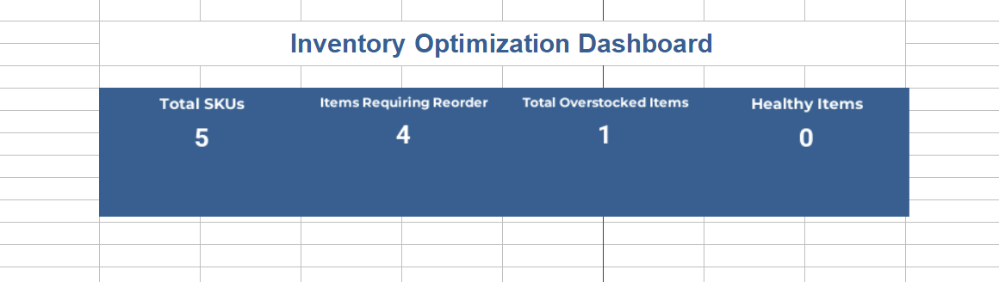
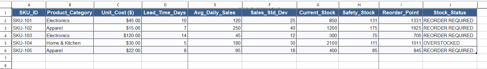

# 📦 Inventory Optimization & Dynamic Safety Stock Replenishment Model

## 📌 Executive Summary
This project builds an automated inventory management and replenishment model in **Microsoft Excel**. By implementing statistical safety stock formulas and dynamic reorder points (ROP), the model helps supply chain teams prevent costly stockouts while minimizing excess capital tied up in slow-moving inventory.

---

## 📊 Inventory Health Dashboard


### Key Dashboard Highlights:
* Real-time tracking of Total SKUs, Reorder Alerts, Overstocked Items, and Healthy Inventory.
* Automated stock status indicators across all product categories.

---

## 🗄️ Inventory Master Table & Formula Logic


### Core Supply Chain Formulas Used:

1. **Safety Stock (95% Service Level / Z = 1.65):**
   Calculates buffer stock required to protect against demand volatility and lead-time variability.
   ```excel
   =ROUNDUP(1.65 * F2 * SQRT(D2), 0)

**Reorder Point (ROP):
**Determines the exact inventory trigger level (Lead Time Demand + Safety Stock) to place a new purchase order.

Excel
=(E2 * D2) + H2

Automated Stock Status Decision Logic:
Uses nested IF statements to dynamically categorize inventory health based on current warehouse stock.

Excel
=IF(G2 <= I2, "REORDER REQUIRED", IF(G2 > (I2 * 2), "OVERSTOCKED", "HEALTHY"))

->Business Value & Outcomes
Eliminates Stockouts: Automatically alerts logistics teams when stock levels hit critical reorder thresholds.

Reduces Carrying Costs: Identifies overstocked items so working capital can be reallocated efficiently.
